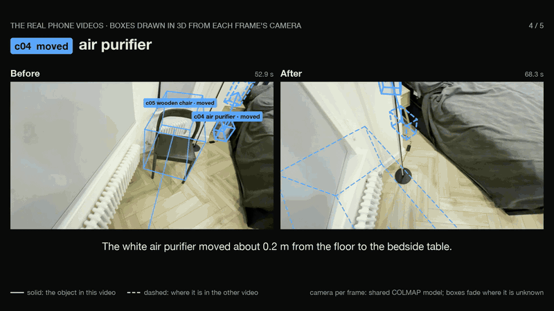
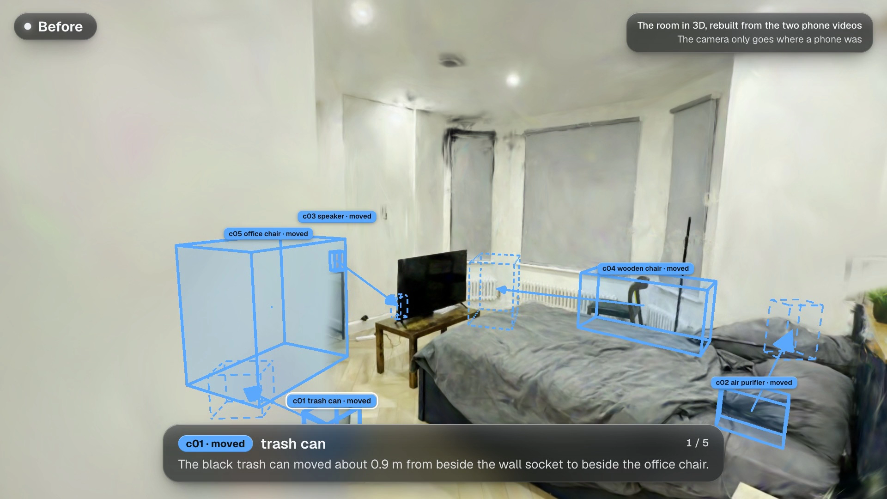
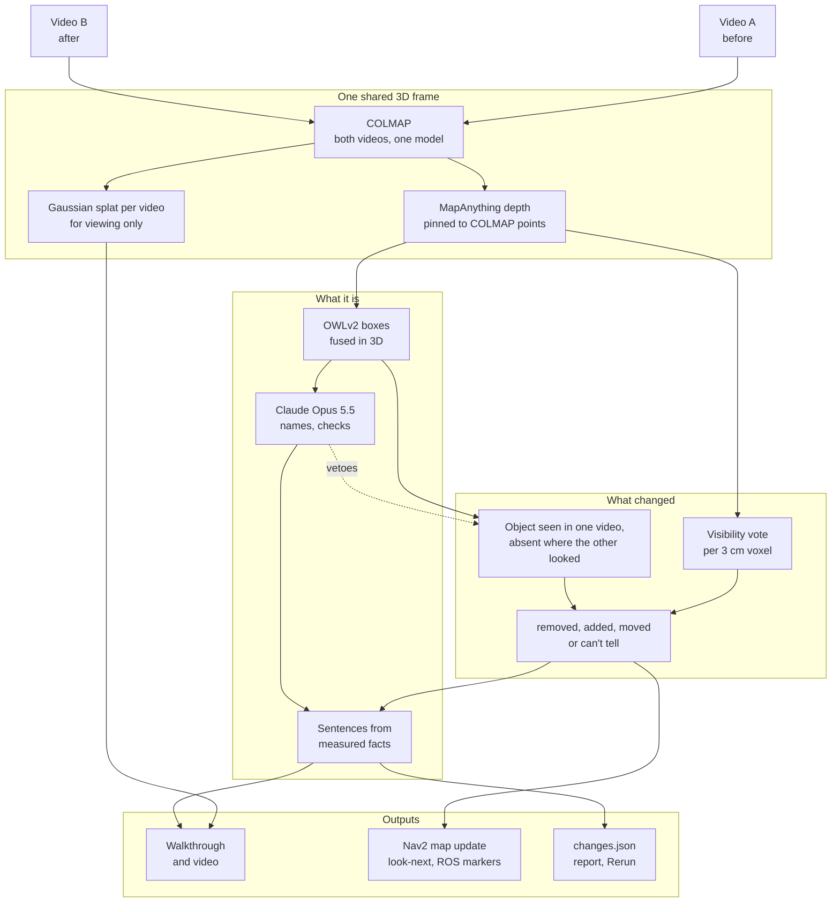

# whatchanged

[](https://github.com/shaanpawa/whatchanged/actions/workflows/ci.yml)

**Film a room twice on a phone. whatchanged finds what was moved, added or removed, shows it in 3D in the
real room, and says it in plain words. What it could not see, it reports as "can't tell", not as unchanged.**

<p align="center">
  <a href="docs/media/whatchanged.mp4"></a>
</p>

**[Results video](docs/media/whatchanged.mp4)** ·
**[Walk the room in 3D](https://shaanpawa.github.io/whatchanged/bedroom-3d/)** ·
**[Change report](https://shaanpawa.github.io/whatchanged/bedroom/report.html)** ·
**[Scorecard](examples/bedroom/scorecard.md)** ·
**[Design note](docs/DESIGN.md)**

**In my bedroom:** I moved five things between two phone videos. whatchanged found all five (four moves,
including a speaker hidden behind the TV, and one chair turned in place), named them correctly, and raised
no false alarms ([scorecard](examples/bedroom/scorecard.md)). A plain point-by-point comparison of the same
videos reports 50 changes.

## The ideas

- **Two witnesses that fail differently.** A *visibility vote* asks, for every 3 cm of space, whether the other video
  saw through where something used to be. The *object detector* asks whether an object one video finds
  steadily is missing where the other video looked straight at it. Each catches what the other misses: the
  vote caught the office chair turned around, the detector caught a 10 cm speaker.
- **Following an object by its own colour.** When something has left its place and nothing turned up at the
  other end, it learns that object's colour from the video that saw it, and looks for it among the other
  video's detections, at the right depth. That is how it found the red speaker half-hidden behind the TV.
  It is not told any colour, and it skips objects without one strong colour.
- **"Can't tell" is an answer.** Space the other video never saw, or saw only through something in the way,
  is reported as not checked, kept apart from "unchanged". A robot should not mark it free.
- **Models describe, geometry measures, and each checks the other.** Claude Opus 5.5 names objects and can
  veto a detector change after looking at both videos' views of the spot; it never proposes a change or a
  number. Every sentence is a template over measured facts, and the run fails if a sentence holds a number
  that is not in them.
- **Built for a robot coming back to a room.** One metric frame (floor at z = 0), a Nav2 map update that
  marks cells the second video never saw as stale rather than free, ROS markers, a scene graph, and where to
  stand next to settle anything it could not see.
- **Scored, not eyeballed.** An answer key, 95% intervals, a naive baseline in every run, and CI that
  rebuilds the example and checks it finds the same changes on every push.

<p align="center"></p>

## Results

My bedroom, filmed on an iPhone 17 (no LiDAR) with the 0.5x lens: before (A, 73 s) and after (B, 85 s).
Both videos are in the [example-inputs release](https://github.com/shaanpawa/whatchanged/releases/tag/v1.0).
The answer key, [`examples/bedroom/ground_truth.yaml`](examples/bedroom/ground_truth.yaml), is my note from
filming, checked against the frames.

| # | What really changed | Result | What it wrote |
|---|---|---|---|
| 1 | Waste bin: middle of the floor to by the desk | moved ✓ | *The black trash can moved about 0.9 m from beside the wall socket to beside the office chair.* |
| 2 | Office chair: turned around where it stood | moved ✓ | *The black office chair next to the desk was turned or shifted in place: it is still there in both videos, but part of the space it filled has changed.* |
| 3 | Wooden chair: along the window wall | moved ✓ | *The brown wooden chair moved about 1.8 m from beside the window blind to beside the radiator.* |
| 4 | Air purifier: floor to bedside table | moved ✓ | *The white air purifier moved about 0.2 m from the floor to the bedside table, 0.6 m up.* |
| 5 | Red speaker: desk to behind the TV | moved ✓ | *The red speaker moved about 1.0 m from the desk to the tv bench, 0.3 m down.* |

- **The hardest one:** behind the TV the speaker is 10 cm across, mostly hidden, and right next to a black
  box that is there in both videos, so the detector's sightings of it merged into that box, and Claude
  rightly said that box was there before. The colour search then found the speaker's red in 5 frames of the
  after video at one spot, 1.0 m from the desk, where the before video saw no such colour in 8 of 8 looks;
  Claude confirmed it.
- **Which witness:** the depth vote found the office chair; the object detector found the other four.
  Claude confirmed 8 of the detector's 12 candidates and turned down 4 (a window blind, books, a desk mat
  and the black box behind the TV).
- **Geometry:** 307 of 309 frames posed in one COLMAP model. Depth fits COLMAP's points to 2.1% (A) and 2.0%
  (B), static surfaces agree to 2.1 cm (median), cameras sit at 1.48 m, and the smallest depth change it
  trusts is about 11 to 13 cm at 1.5 to 2.2 m from the camera.
- **Not done for this pair:** no untouched repeat (A2), so the vote ran on default thresholds rather than
  calibrated ones; no floor marker or tape, so the scale is MapAnything's metric depth and move distances are
  not checked against a tape. The object-level test, the turn-in-place rule and the colour search were added
  after earlier passes over this pair, so it is not a held-out test for them ([design note, section 5](docs/DESIGN.md#5-a-second-witness-the-object-detector)).

On a trial video of the same room (one walk split into two overlapping clips, nothing changed): **0 changes**,
where the plain point difference reports 40.

## Quickstart

**See the result in a minute** (no GPU, no model download, no API key; needs [uv](https://docs.astral.sh/uv/)):

```bash
git clone https://github.com/shaanpawa/whatchanged && cd whatchanged
uv venv --python 3.12
uv pip install numpy scipy pillow pyyaml opencv-python-headless "rerun-sdk==0.24.1" && uv pip install -e . --no-deps
.venv/bin/whatchanged demo                          # rebuilds the example into out/demo from its cached 3D
open out/demo/report.html                           # the change report
python3 -m http.server -d examples/bedroom-3d 8000  # the 3D walkthrough, at localhost:8000
```

**Run it on two videos** (an Apple Silicon Mac for the photoreal room and the video; COLMAP 4, ffmpeg, and
Chrome for the video's 3D tour):

```bash
brew install colmap ffmpeg
uv sync --extra room --extra claude                 # PyTorch, MapAnything, msplat; weights download on first run
uv run whatchanged check before.mp4 after.mp4       # footage warnings (HDR, portrait, too short)
uv run whatchanged all before.mp4 after.mp4 --out out/mine
```

`all` runs every step, one heavy job at a time: one COLMAP model and a splat per video, change detection on
the same cameras, the walkthrough with the boxes, and the results video. On the example inputs it takes
about 35 minutes on an M4 Pro. Add `--key ground_truth.yaml` to score the result. Then open
`out/mine/run/report.html` and serve `out/mine/room` for the walkthrough.

**Claude is optional.** Put `ANTHROPIC_API_KEY=...` in a git-ignored `.env`. Without it no API is called:
boxes keep OWLv2's labels, changes are named by SigLIP 2 on the CPU, and the detector's changes are kept
without Claude's second look, so expect a few more false ones.

**On Linux:** change detection runs; the photoreal room and the video need Apple Silicon. With COLMAP 4,
`whatchanged run before.mp4 after.mp4 --poses colmap --out out/run` runs both witnesses as above. Without it,
`whatchanged run before.mp4 after.mp4 --out out/run` takes the cameras from MapAnything and runs the depth
vote only. With nothing installed: fork the repo, open *Actions → run on your own videos* and paste two direct
download links (the same MapAnything path). The links and the report, with frames of your room, are visible to
anyone who can see the fork, so strip location tags first (`scripts/ingest.py`).

| Command | What it does |
|---|---|
| `all A B --out DIR` | Everything below, in order |
| `check A B` | Footage warnings before any 3D |
| `room A B --out DIR` | One COLMAP model, one Gaussian splat per video, the walkthrough viewer (`--detections RUN` adds the boxes) |
| `run A B --poses colmap --colmap-from ROOM` | Change detection: report, maps, object boxes, `changes.json` |
| `video ROOM --detections RUN` | Results video: title, real footage with tracked boxes, 3D tour, end card |
| `report DIR` | Redo everything after the 3D step from the cache (seconds) |
| `demo` | The bundled example, from its cache |
| `score DIR key.yaml` | Recall, precision (95% intervals) and false alarms against an answer key |
| `calibrate DIR` | Thresholds from an untouched pair, frozen to `config.frozen.json` |

[`scripts/protocol.sh`](scripts/README.md) is the full filming protocol behind the example: an untouched repeat
(A2) to calibrate the thresholds before the real pair, and a printed floor marker for scale.

## How it works



1. **Poses.** The sharpest frame in each half second of both videos goes into one COLMAP model (SIFT,
   neighbours in time plus a sparse all-pairs net that closes loops, global mapper). If either video does not
   join the model, it stops there and says which.
2. **Depth.** MapAnything runs on each video's keyframes separately, so it never sees both versions of a
   changed spot. Each frame's depth is fitted to the COLMAP points it saw; depth with no point nearby (a
   plain white wall) is dropped, so it becomes *can't tell* instead of a guess. A video whose depth fits its
   own points worse than 8% gets a warning: the camera model, not the room, is off.
3. **Vote.** For every voxel one video saw, each camera of the other video compares its own depth there:
   further means *free* (it saw through where the thing was), equal means *seen*, nearer means *occluded*.
   The tolerance is 3 times the room's own noise floor, measured per distance band on what both videos saw.
4. **Objects.** OWLv2 finds objects in up to 40 keyframes per video, with the room's own nouns (from Claude)
   added to its queries. Detections from both videos are fused into **one** set of 3D boxes, so Before and
   After show the same static objects and differ only where a change is.
5. **Second witness.** For each box, how often does each video's detector find it in the frames that should
   show it? Found steadily in one video and in at most 20% of at least 3 frames of the other: gone there,
   if Claude, shown both views, agrees. A removal and an addition of the same thing are one move. A change
   inside an object both videos still see where it is (the chair turned around) is a turn in place. An
   object that left with no other end found is looked for by its own colour (learnt from the video that saw
   it) among the other video's detections of its kind, at the right depth, for Claude to confirm.
6. **Words.** Claude names each change from its before and after crops, told the name of the box it sits
   in so the two agree. The sentence is a template filled with the measurements.
7. **Map and next view.** The updated occupancy map changes only cells video B looked at. For each region it
   could not check, it scores standing spots on free floor by how much of the region a camera there would see.

Why each choice, with the numbers behind it: [docs/DESIGN.md](docs/DESIGN.md).

## Outputs for robots

All in one levelled metric frame: metres, z up, floor at z = 0, yaw about +z.

| File | What it is | Format |
|---|---|---|
| `maps/map_{before,after,updated}.yaml/.pgm` | Occupancy maps. *Updated* changes only cells video B saw; cells it never saw keep their old value and are listed as stale (`map_update.json`) | Nav2 `map_server` |
| `viewpoints.json` | Where to stand and which way to face to settle each *can't tell* region, with the share it would see | x, y, yaw, tilt |
| `markers_{before,after}.json` | One box and one label per object | `visualization_msgs/MarkerArray` (rosbridge JSON) |
| `scene_graph_{before,after}.json` | Objects with *on* and *near* relations | JSON, frame `map` |
| `objects_{A,B}.txt` | The object layout | SpatialLM `Bbox(class,x,y,z,angle_z,scale_x,scale_y,scale_z)` |
| `objects.json` | One object set for both videos: state (both, before only, after only, moved), who saw it, Claude's verdict | JSON |
| `changes.json` | Every change: type, name, sentence, 3D box, evidence (which witness, views, share, noise margin), video timestamps, *can't tell* regions, smallest detectable change | JSON |
| `scene.rrd` | Both scans, every camera, the boxes and the changes | [Rerun](https://rerun.io) |
| `A.spz`, `B.spz`, `scene.json` | A Gaussian splat per video in the shared frame, and the camera path | SPZ, for a simulator or the viewer |

## Where Claude is used, and where it is not

Claude Opus 5.5 is a **judge**. Geometry places every box and measures every number. A change stands only on
measured evidence (the depth vote, or the detector's frame counts), which Claude can veto but never create.

| Claude does | Claude does not |
|---|---|
| List the room's objects from one contact sheet, so OWLv2 looks for "radiator" instead of forcing it into "heater" | Estimate cameras, depth or scale |
| Look at up to three crops of each 3D box with its wireframe drawn in: keep or drop, a plain name, part of what, colour, and whether the box fits | Draw, place or size a box (a box it calls too small or too big is refitted by geometry and shown to it again) |
| Check each change the object detector proposes: the object in its own video beside the other video's view of the same spot. Is it still there? | Propose a change, or say where it went or how far |
| Name each change from before and after crops, told the name of the box at that spot so the two agree | Say where a change is or how far it moved |
| Write the video's one-line summary, rejected if it contains a number that is not in the measured facts | Write the change sentences (templates over measured facts) |

Every answer is structured JSON, cached on disk, so a rerun costs nothing and finds the same changes (CI
replays the example with no key). A full run of the real pair makes about 100 calls, about $1.20. Without a
key, everything runs locally.

## Evaluation

- **Unit tests** (no models or keys; after the light install above, `uv pip install pytest && .venv/bin/python
  -m pytest -q`; CI runs them on every push). A synthetic room rendered by ray casting checks the brief's traps: a viewpoint change alone reports nothing, a removed box is *removed*, a
  box hidden behind a new obstacle is **not** called removed, a moved and turned box is *moved* with its
  distance and turn.
  Also: COLMAP guards, the shared object set, the detector witness, the turn-in-place rule, the colour search
  and Claude's check (with a fake client), the scorecard, the one-command pipeline and the video's pose
  interpolation.
- **Untouched repeat.** The protocol films a second pass with nothing moved (A2), which must report nothing;
  thresholds are calibrated on it and frozen to `config.frozen.json` before A vs B is run. The trial's
  untouched pair reported 0. The real pair was filmed without one and ran on the default thresholds.
- **Answer key.** The real pair is scored against `examples/bedroom/ground_truth.yaml` with 95% Wilson
  intervals (`whatchanged score`). A printed ArUco marker (`scripts/marker_scale.py`) and a tape measure can
  check the scale and the move distances; neither was used for this pair.
- **Baseline.** Every run also reports the plain point difference (a point is changed if the other video has
  nothing within 5 cm): 40 changes on the untouched trial (the vote: 0), 50 on the real pair (whatchanged: 5).
- **CI** rebuilds the committed example from its cache with no key and no model, checks it finds the same
  changes, scores it, and publishes the reports and the walkthrough to GitHub Pages.

## Limitations

- **Phone video only.** No LiDAR or IMU. Scale comes from the network's metric depth or a printed marker.
- **Plain walls are blind spots.** Depth is kept only where COLMAP has points (about half the pixels on the
  trial), so a change against a white wall is *can't tell*, not found.
- **Small things need the detector.** On the real pair the smallest depth change it trusts is about 11 to
  13 cm at 1.5 to 2.2 m from the camera and 26 to 40 cm beyond 2.5 m; every run writes its own figure to
  `changes.json`. Smaller things are found only if the detector boxes them (the 10 cm speaker was).
- **A move needs both ends.** The far end comes from the detector or, for an object with one strong colour,
  from that colour. A grey or black object that ends up hidden behind something is reported as no longer at
  its old spot, not as moved.
- **COLMAP's calibration is not always right.** In 2 of 3 builds of this pair, the after video's focal
  length came out 3 to 10% off; its depth then fitted its own points to 13 to 19% instead of 2%, and the
  result got worse (a false change, a wrong move). Every run warns when this happens; rebuild the room folder
  with `--force`. The committed example is from the good build.
- **Splats are sharp only near filmed views.** Held-out frames on the walked path render at about 30 dB
  PSNR; a few centimetres and degrees off the path they blur. So the viewer is a walkthrough along the filmed
  path, not free flight.
- **Fast turns lose poses.** COLMAP leaves gaps where the phone turned quickly; the footage overlay fades its
  boxes out there rather than guess.
- **Time.** On an M4 Pro for the real pair: COLMAP 2 to 5 min for about 310 frames, the 30k-step splats
  about 9.5 min per video, detection 3.5 to 7 min (MapAnything on the CPU, OWLv2, Claude), the results video
  3.5 min. COLMAP
  time grows faster than the frame count (6.8 times longer for 2.4 times the frames on the trial). The
  photoreal room and the video need an Apple Silicon Mac.
- **Lighting.** Both videos should be filmed under the same lights, in SDR. A large lighting change can look
  like a change in depth. The real pair was filmed with HDR on (`whatchanged check` warns), so its colours
  are a little flat.

## Related work

- Fehr et al., *TSDF-based change detection for consistent long-term dense reconstruction*, ICRA 2017: unexplored space is not empty space.
- Hornung et al., *OctoMap*, Autonomous Robots 2013: free, occupied and unknown as first-class map states.
- Weihs et al., *Visual Room Rearrangement*, CVPR 2021: an agent must find what changed in a room.
- Wu et al., *SceneDiff*, arXiv 2512.16908: a benchmark and method for multiview object change detection.
- Mao et al., *SpatialLM*, arXiv 2506.07491: the 3D box layout format and the boxes-on-real-footage look.
- Keetha et al., *MapAnything*, arXiv 2509.13414, and Schönberger and Frahm, *Structure-from-Motion Revisited* (COLMAP), CVPR 2016.

## Licences

Code: MIT. Models and libraries, all usable commercially:
MapAnything code and `map-anything-apache` weights (Apache-2.0), OWLv2 (Apache-2.0), SigLIP 2 (Apache-2.0),
COLMAP (BSD), msplat (Apache-2.0), Spark (MIT), three.js (MIT), Rerun (MIT or Apache-2.0).
Claude Opus 5.5 is called through the Anthropic API under Anthropic's terms; no weights are shipped.
