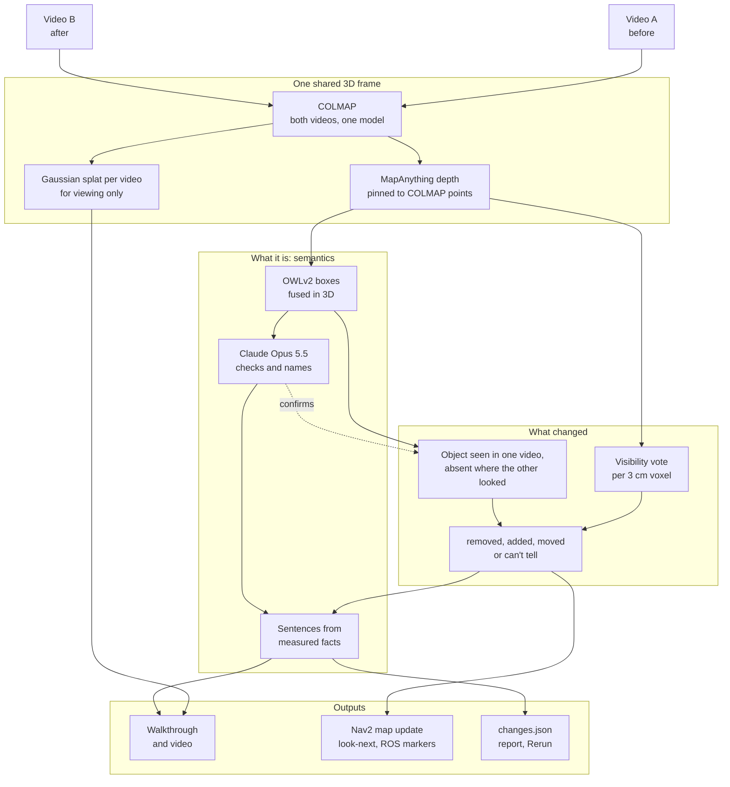

# whatchanged

**Two phone videos of a room in; out comes what was moved, added or removed, in 3D and in plain words,
plus the update to a robot's map.**

[](https://github.com/shaanpawa/whatchanged/actions/workflows/ci.yml)

<p align="center">
  <a href="docs/media/whatchanged.mp4"></a>
</p>

**[Results video](docs/media/whatchanged.mp4)** ·
**[Walk the room in your browser](https://shaanpawa.github.io/whatchanged/bedroom-3d/)** ·
**[Change report](https://shaanpawa.github.io/whatchanged/bedroom/report.html)** ·
**[Design note](docs/DESIGN.md)**

## What it does

The brief asks for three things. Each maps to one stage.

| The brief | whatchanged |
|---|---|
| A shared 3D representation from the two recordings | Both videos are posed together in **one COLMAP model**. MapAnything gives metric depth for every keyframe, pinned to COLMAP's points. Floor at z = 0, metres. Each video also gets a photoreal Gaussian splat in that same frame. |
| Identify and visualise what was moved, added or removed, in 3D | Two witnesses. A **visibility vote** per 3 cm voxel: did the other video see through where this was? Too few votes means **can't tell**, kept apart from "unchanged". And the **object detector**: an object one video finds steadily and the other never finds where it looked, confirmed by Claude. A removal and an addition of the same thing are one **move**, with its distance. Shown as coloured 3D boxes in a walkthrough of the real room, on the real footage, in a report and in Rerun. |
| Describe the changes with labels or language | Every object gets a 3D box (OWLv2 detections fused in 3D). **Claude Opus 5.5** checks and names each box from crops. Sentences are templates filled with the measured numbers, and a check fails the run if a number is not in the facts. |

For a robot coming back to a room it mapped before, it also writes the **Nav2 map update** (cells the second
video never saw are marked stale, not free) and **where to stand next** to check anything it could not see.

<p align="center"></p>

## Results

My bedroom, filmed on an iPhone 17 (no LiDAR) with the 0.5x lens: before (A, 73 s) and after (B, 85 s). In
between I moved five things. The answer key, [`examples/bedroom/ground_truth.yaml`](examples/bedroom/ground_truth.yaml),
is my note from filming, checked against the frames.

| # | What really changed | Result | What it wrote |
|---|---|---|---|
| 1 | Waste bin: middle of the floor to under the desk | found | *The black trash can moved about 0.9 m from beside the wall socket to beside the office chair.* |
| 2 | Office chair: pulled out from the desk and turned | one end | *The black office chair on the floor next to the desk is gone; video B saw that spot empty from 4 viewpoints.* |
| 3 | Wooden chair: along the window wall | found | *The brown wooden chair moved about 1.8 m from beside the window blind to beside the radiator.* |
| 4 | Air purifier: floor to bedside table | found | *The white air purifier moved about 0.2 m from the floor to the bedside table.* |
| 5 | Red speaker: desk to TV bench | one end | *The red speaker on the desk next to the remote control is gone; video B looked at that spot from 7 viewpoints and did not find it.* |

**3 of 5 found as moves, the other 2 found gone from their old place, 0 false alarms.** The plain point
difference reports 50 changes on the same pair. Neither partial result is a wrong claim: the chair and the
speaker did leave those spots. What was not found is where they went: the speaker's new place never got a box
of its own, and the office chair moved only partly out of its old box.

- **Two witnesses.** The depth vote found the office chair. The object detector found the other four, and
  Claude confirmed 7 of its 11 candidates. It turned down a window blind, a book, a spray bottle and a black
  box behind the TV that was there in both videos.
- **Geometry.** 307 of 309 frames posed in one COLMAP model. Depth fits COLMAP's points to 2.1% (A) and 2.0%
  (B), static surfaces agree to 2.1 cm (median), cameras sit at 1.48 m. The smallest depth change it trusts
  is about 11 to 13 cm at 1.5 to 2.2 m from the camera.
- **Claude.** About 120 calls over every run on this pair, about $1.45. All answers are cached, so the replay
  and CI cost nothing and need no key.
- **Not done for this pair.** No untouched repeat (A2), so the vote ran on default thresholds rather than
  calibrated ones. No floor marker or tape, so the scale is MapAnything's metric depth (corrected for its
  1.19x focal-length guess) and move distances are not checked against a tape.
- The object-level test was added after a first pass over this pair found nothing
  ([design note, section 5](docs/DESIGN.md#5-a-second-witness-the-object-detector)), so this pair is not a
  held-out test for it.

On a trial video of the same room (one walk split into two overlapping clips, nothing changed): **0 changes**,
where the plain point difference reports 40. Static surfaces of the two clips agree to 0.8 cm (median).

## Quickstart

Needs macOS on Apple Silicon for the photoreal room (Linux works for detection, see below),
[uv](https://docs.astral.sh/uv/), and COLMAP 4 and ffmpeg (`brew install colmap ffmpeg`).

```bash
git clone https://github.com/shaanpawa/whatchanged && cd whatchanged
uv sync --extra room --extra claude   # Python 3.12, PyTorch, MapAnything, msplat
uv run whatchanged demo               # rebuild the bundled example from its cached 3D
```

On your own two videos (MapAnything fetches 4.9 GB of weights on the first run):

```bash
uv run whatchanged check before.mov after.mov            # HDR, portrait, short clips
uv run whatchanged run before.mov after.mov --poses colmap --out out/run
uv run whatchanged room before.mov after.mov --detections out/run --out out/room
uv run whatchanged video out/room --detections out/run   # out/room/whatchanged.mp4
open out/run/report.html                                 # the change report
python3 -m http.server -d out/room 8000                  # the walkthrough, at localhost:8000
```

`scripts/morning.sh` runs the whole protocol one heavy step at a time: ingest (strips location tags), a
fast first pass, the untouched repeat, calibration, the real pair, the viewer, the video and the score.
See [scripts/README.md](scripts/README.md).

**Claude is optional.** Put `ANTHROPIC_API_KEY=...` in a git-ignored `.env`. Without it no API is called:
boxes keep OWLv2's labels and changes are named by SigLIP 2 on the CPU.

**Without a Mac or COLMAP:** `whatchanged run before.mp4 after.mp4` (MapAnything's own poses) runs on Linux,
CPU or CUDA. Or fork the repo, open *Actions → run on your own videos*, paste two video links and download
the report from the finished run.

| Command | What it does |
|---|---|
| `check A B` | Footage warnings before any 3D |
| `run A B --out DIR` | Detection pipeline (`--poses colmap` shares cameras with `room`) |
| `room A B --out DIR --detections RUN` | One Gaussian splat per video, walkthrough viewer with the boxes |
| `video ROOM --detections RUN` | Results video: title, real footage with tracked boxes, 3D tour, end card |
| `report DIR` | Redo everything after the 3D step from the cache (seconds) |
| `calibrate DIR` | Thresholds from an untouched pair, frozen to `config.frozen.json` |
| `score DIR key.yaml` | Recall, precision (95% intervals), traps, move error against an answer key |

## How it works



1. **Poses.** The sharpest frame in each short window of both videos goes into one COLMAP model (SIFT,
   neighbours in time plus a sparse all-pairs net that closes loops, global mapper). If either video does not
   join the model, it stops there, before any depth or training, and says which.
2. **Depth.** MapAnything runs on each video's keyframes separately, so it never sees both versions of a
   changed spot. Each frame's depth is fitted to the COLMAP points it saw; depth with no point nearby (a
   plain white wall) is dropped, so it becomes *can't tell* instead of a guess. Scale comes from the
   network's metric depth, corrected for its own focal-length guess, or from a printed floor marker.
3. **Vote.** For every voxel one video saw, each camera of the other video compares its own depth there:
   further means *free* (it saw through where the thing was), equal means *seen*, nearer means *occluded*.
   Removals are A judged by B; additions are B judged by A.
4. **Tolerance from the room.** Most of what both videos saw did not change, so the spread of their depth
   disagreement, per distance band, is the noise floor. The tolerance is 3 times it. Thresholds are then
   frozen on the untouched pair before the real pair is run.
5. **Second witness.** The vote is only as good as the depth (on a first pass over the real pair, a subtly
   wrong camera model raised its noise floor to 16 to 39% and it found nothing; the run now warns when that
   happens). So the object detector also votes: for each box, how often each video's frames that should show
   it have a detection of it. Found steadily in one video
   and in at most 20% of at least 3 frames of the other: gone there. Claude then looks at both views of the
   spot and keeps only what is really absent. Same-name pairs are moves.
6. **Objects.** OWLv2 finds objects in up to 40 keyframes per video, with the room's own nouns added to its
   queries. Detections from both videos are fused into **one** set of 3D boxes, so Before and After show the
   same static objects and differ only where a change is.
7. **Names and sentences.** Claude judges each box (see below). Each change is named from its before and
   after crops, told the name of the box it sits in so the two agree. Its sentence is a template filled with
   the measurements, for example *"The wooden chair moved about 1.2 m from beside the window to beside the
   bed and turned about 90°."*
8. **Map and next view.** The updated occupancy map patches the old one only where video B looked. For each
   region it could not check, it scores standing spots on free floor by how much of the region a camera there
   would see past the current obstacles.

Why each choice, with the numbers behind it: [docs/DESIGN.md](docs/DESIGN.md).

## Outputs for robots

All in one levelled metric frame: metres, z up, floor at z = 0, yaw about +z.

| File | What it is | Format |
|---|---|---|
| `maps/map_{before,after,updated}.yaml/.pgm` | Occupancy maps. *Updated* changes only cells video B saw; cells it never saw keep their old value and are listed as stale (`map_update.json`) | Nav2 `map_server` |
| `viewpoints.json` | Where to stand and which way to face to settle each *can't tell* region, with the share it would see | x, y, yaw, tilt |
| `markers_{before,after}.json` | One box and one label per object | `visualization_msgs/MarkerArray` (rosbridge JSON) |
| `scene_graph_{before,after}.json` | Objects with *on* and *near* relations | JSON, frame `map` |
| `objects_{A,B}.txt` | The object layout | SpatialLM `Bbox(class,x,y,z,angle_z,scale_x,scale_y,scale_z)` |
| `objects.json` | One object set for both videos: state (both, before only, after only, moved), who saw it, Claude's verdict | JSON |
| `changes.json` | Every change: type, name, sentence, 3D box, evidence (free views, share, noise margin), video timestamps, *can't tell* regions, smallest detectable change | JSON |
| `scene.rrd` | Both scans, every camera, the boxes and the changes | [Rerun](https://rerun.io) |
| `A.spz`, `B.spz`, `scene.json` | A Gaussian splat per video in the shared frame, and the camera path | SPZ, for a simulator or the viewer |

## Where Claude is used, and where it is not

Claude Opus 5.5 is a **judge**. Geometry places every box and measures every number. A change stands only on
measured evidence (the depth vote, or the detector's frame counts), which Claude can veto but never create.

| Claude does | Claude does not |
|---|---|
| List the room's objects from one contact sheet, so OWLv2 looks for "radiator" instead of forcing it into "heater" | Estimate cameras, depth or scale |
| Look at up to three crops of each 3D box with its wireframe drawn in: keep or drop, a plain name, part of what, colour, and whether the box fits | Draw, place or size a box (a box it calls too small or too big is refitted by geometry and shown to it again) |
| Check each change the object detector proposes: the object in its own video beside the other video's view of the same spot. Is it still there? | Propose a change, or say where it went or how far |
| Name each change from before and after crops, told the name of the box at that spot so the two agree | Say where a change is or how far it moved |
| Write the video's one-line summary, rejected if it contains a number that is not in the measured facts | Write the change sentences (templates over measured facts) |

Every answer is structured JSON, cached on disk by image hash and prompt, so a rerun costs nothing and gives
the same result. On the real pair: about 120 calls, about $1.45. Without a key, everything runs locally.

## Evaluation

- **Unit tests (89, on every push, about 15 s, no models or keys).** A synthetic room rendered by ray casting checks the
  brief's traps: a viewpoint change alone reports nothing, a removed box is *removed*, a box hidden behind a
  new obstacle is **not** called removed, a moved and turned box is *moved* with its distance and turn.
  Also: COLMAP guards, the shared object set, the detector-based change test and Claude's check of it, Claude
  naming with a fake client (refusals, bad key, merges), the scorecard, and the video's pose interpolation.
- **Untouched repeat.** The protocol films a second pass with nothing moved (A2), which must report nothing;
  thresholds are calibrated on it and frozen to `config.frozen.json` before A vs B is run. The trial's
  untouched pair reported 0. The real pair was filmed without one and ran on the default thresholds.
- **Answer key.** The real pair is scored against `examples/bedroom/ground_truth.yaml` with 95% Wilson
  intervals (`whatchanged score`). A printed ArUco marker (`scripts/marker_scale.py`) and a tape measure can
  check the scale and the move distances; neither was used for this pair.
- **Baseline.** Every run also reports the plain point difference (a point is changed if the other video has
  nothing within 5 cm): 40 changes on the untouched trial (the vote: 0), 50 on the real pair (whatchanged: 5).
- **CI** rebuilds the committed example from its cache with no key and no model, checks it finds the same
  changes, scores it, and publishes the reports and the walkthrough.

## Limitations

- **Phone video only.** No LiDAR or IMU. Scale comes from the network's metric depth or a printed marker.
- **Plain walls are blind spots.** Depth is kept only where COLMAP has points (about half the pixels on the
  trial), so a change against a white wall is *can't tell*, not found.
- **Small things need the detector.** On the real pair the smallest depth change it trusts is about 11 to
  13 cm at 1.5 to 2.2 m from the camera and 30 to 40 cm beyond 2.5 m; every run writes its own figure to
  `changes.json`. Smaller things are found only if the detector boxes them (the 10 cm speaker was).
- **A move needs a box at both ends.** The speaker's new place was never boxed on its own and the office
  chair stayed partly inside its old box, so each was reported gone from its old place, not moved.
- **Splats are sharp only near filmed views.** Held-out frames on the walked path render at about 30 dB
  PSNR; a few centimetres and degrees off the path they blur. So the viewer is a walkthrough along the filmed
  path, not free flight.
- **Fast turns lose poses.** COLMAP leaves gaps where the phone turned quickly; the footage overlay fades its
  boxes out there rather than guess.
- **Time.** On an M4 Pro for the real pair: COLMAP 2 min for 309 frames, the 30k-step splats about 9.5 min
  per video, detection 3.5 min (MapAnything on the CPU, OWLv2, Claude), the results video 3.5 min. COLMAP
  time grows faster than the frame count (6.8 times longer for 2.4 times the frames on the trial). The
  photoreal room and the video need an Apple Silicon Mac.
- **Lighting.** Both videos should be filmed under the same lights, in SDR. A large lighting change can look
  like a change in depth. The real pair was filmed with HDR on (`whatchanged check` warns), so its colours
  are a little flat.

## Related work

- Fehr et al., *TSDF-based change detection for consistent long-term dense reconstruction*, ICRA 2017: unexplored space is not empty space.
- Hornung et al., *OctoMap*, Autonomous Robots 2013: free, occupied and unknown as first-class map states.
- Weihs et al., *Visual Room Rearrangement*, CVPR 2021: an agent must find what changed in a room.
- Wu et al., *SceneDiff*, arXiv 2512.16908: a benchmark and method for multiview object change detection.
- Mao et al., *SpatialLM*, arXiv 2506.07491: the 3D box layout format and the boxes-on-real-footage look.
- Keetha et al., *MapAnything*, arXiv 2509.13414, and Schönberger and Frahm, *Structure-from-Motion Revisited* (COLMAP), CVPR 2016.

## Licences

Code: MIT. Models and libraries, all usable commercially:
MapAnything code and `map-anything-apache` weights (Apache-2.0), OWLv2 (Apache-2.0), SigLIP 2 (Apache-2.0),
COLMAP (BSD), msplat (Apache-2.0), Spark (MIT), three.js (MIT), Rerun (MIT or Apache-2.0).
Claude Opus 5.5 is called through the Anthropic API under Anthropic's terms; no weights are shipped.
